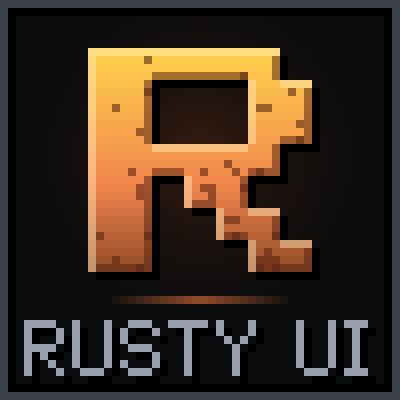

<h1>RustyUI</h1>

A clean, flat reskin of the default World of Warcraft UI.

RustyUI gives Blizzard's frames near-black panels, borders one screen pixel thin with a one-pixel dark rim, square icons and an accent color.

It restyles Blizzard's own frames rather than replacing them. Frames keep their places, Edit Mode keeps working, and nothing is moved or hidden in combat.

Works on Retail and WoW Forever, from the same download.

➡️ [Download on CurseForge](https://www.curseforge.com/wow/addons/rustyui) · 🌐 [Website](https://rui.rustydaemon.com)

## What it skins

- **Action bars**: square, bordered buttons with flat press and highlight states, and no bar art. Keybindings and macro names can be shown or hidden, and keybindings are written short: `sM4` for Shift-Mouse Button 4, `cN5` for Ctrl-Numpad 5. A button turns red while your target is out of its range. Empty slots stay hidden until a spell is being dragged, unless you choose to show them. On WoW Forever, button spacing and the gap between bars can be set; on Retail, Edit Mode handles both.
- **Menu and bags**: the micro menu as kit tiles with their own icons and a pulsing accent dot when Blizzard flags one, and the bag bar as square slots, each on a kit panel. The queue eye sits in a kit slot.
- **XP bar**: RustyUI's own experience bar in place of Blizzard's, in four styles switched live: Slim, Segmented, Panel (level, bar and numbers always shown) and Screen edge (a glowing line along the bottom of the screen). Rested experience shows as a soft extension of the fill. At the level cap it shows the watched reputation instead, renown and paragon included, or hides if you set it to.
- **Bags**: kit-style bag windows, with slots bordered in the item's quality color.
- **Unit frames**: player, target, focus, target of target, pet, party and boss frames with flat health and power bars. Health is class-colored for players and reaction-colored otherwise, and the empty part of the bar is a dim shade of that color. On Retail, portraits are square and elites get an accent border.
- **Raid frames**: Blizzard's raid frames, and its party frames when they are raid-style, with flat health and power bars, a 1px border along each frame's edge, and the empty part of the health bar a dim shade of the color Blizzard gives it. Aggro shows as a 1px border in its threat color, and your target as a light line just inside it.
- **Nameplates**: four styles, switched live: Slim (a flat bar with a 1px border at Blizzard's height), Framed (the name and bar together in a kit window), Thick and Minimal (a thin line under the name). Bar heights follow Blizzard's nameplate size. The empty part of the bar is a dim shade of its color, and the cast bar is flat and colored by cast type. Your target is outlined in a second 1px line in the color Blizzard gives it, or on Framed the window's border takes that color; a soft target is underlined. Friendly NPCs can be set to show only their name. The shield on casts that cannot be interrupted stays. Friendly nameplates in dungeons and raids are closed to addons and keep Blizzard's look.
- **Minimap**: five styles, switched live: Square, Rounded, Round (with an accent ring), Hexagon, and Window (the map in a kit window, with the zone above and coordinates and time below). The day/night indicator can be hidden, and an edge distance slider pulls the zone, clock, coordinates and minimap buttons closer to the map or pushes them out.
- **Tooltips**: flat panels bordered in the item's quality color. A player's tooltip is bordered in their class color and anyone else's by reaction, and the health bar under it takes the same color.
- **Cast bars**: four styles, switched live: Slim, Framed (in a kit window with the spell name in a title bar), Thick (name and time on the bar, icon fused to its end) and Minimal (a thin line with the name above). Colored by cast type; the player's bar marks latency at its end.
- **Buffs and debuffs**: square icons, with debuff borders in their type color. Timers are written short (`12m`, `3h`, `45`) and turn red in their last 5 seconds.
- **Objective tracker**: headers as kit headings over an accent rule, and quest item buttons as square slots.
- **Popups and game menu**: confirmation popups and the Escape menu as kit windows with an accent stripe and kit buttons.
- **Timers and extra button**: flat breath, fatigue and countdown bars; the extra action and zone ability buttons as square slots without their ornate frames.
- **Talents window**: the window and its tabs in the kit's look. On the classic-style talent frame, talents are square slots bordered in their state color (green while points can go in, gold when full, gray while locked), over the tree's own background art.
- **Character window**: the window, its tabs and its insets in the kit's look. Gear sits in square slots bordered in the item's quality color, the stats are kit headings over an accent rule, and the item flyout (Alt over a slot) is a kit panel of slots. The model and its background art stay. On WoW Forever, the two panes and the icon tabs down the side are skinned too.
- **Quest, gossip, merchant and mail**: the windows NPCs open, as kit windows with kit buttons, tabs and edit boxes. Merchant goods, quest rewards and required items, mail in the inbox and mail attachments sit in square slots bordered in their quality color. The parchment pages stay, because quest and gossip text is written in dark ink for them.
- **Chat**: flat tabs with an accent underline on the selected one, and a kit-style input box.

Every border is one physical screen pixel at any UI scale, and is measured again when the scale or resolution changes.

## Settings

`/rui` opens the settings window. It remembers where you left it and which page you were on, and closes on Escape.

- **Modules**: each one can be turned off.
- **Accent color**: Gold, Rust, Teal, Violet, Azure, Rose, Fel or Frost, each shown as a preview card of the kit in that color. Borders can take the accent color too.
- **Font**: Blizzard's font, or Rusty Pixel, RustyUI's own pixel font. It is used for RustyUI's windows and for the numbers on skinned frames: hotkeys, stack counts, health text and cast timers.
- **Font size**: scales RustyUI's text from 80% to 140%. Sizes round to whole pixels, which keeps Rusty Pixel sharp.
- **Styles**: the minimap, XP bar, cast bar and nameplate styles are picked from preview cards and change right away.
- Each module's page has its own options, such as keybindings on action bars, class-colored health, and quality borders on bags, tooltips, the character window and NPC windows.

## Slash commands

| Command    | What it does                      |
| ---------- | --------------------------------- |
| `/rui`     | Open or close the settings window |
| `/rustyui` | Same as `/rui`                    |

On Retail, the addon compartment opens the settings too.

## License

GNU General Public License version 3. See [LICENSE.md](LICENSE.md).
